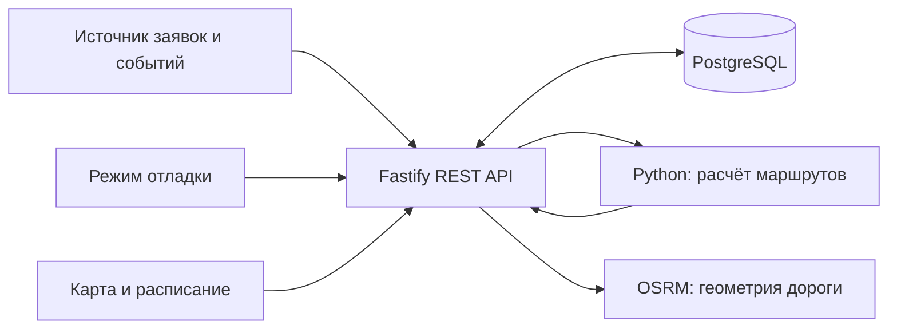

# Техническая документация

## 1. Назначение

Система назначает выездные работы сотрудникам, строит маршруты и изменяет
расписание при новых заявках, задержках, отменах и недоступности исполнителей.
Документ описывает реализацию на коммите `ef9ffec`, включая оборудование
и режим отладки. Внешний контракт — [api_spec.yaml](api_spec.yaml).

## 2. Архитектура

| Компонент | Реализация | Ответственность |
|---|---|---|
| REST API | Node.js 22, TypeScript, Fastify 5 | Валидация, состояние смены, вызов расчёта, транзакции |
| Планировщик | Python 3.12 | Назначения, порядок остановок, расписание, переносы |
| База | PostgreSQL 16 | Справочники, матрица, календарь, планы и события |
| Интерфейс | JavaScript, MapLibre GL JS | Карта, Гант, предупреждения и остатки оборудования |
| Режим отладки | Python HTTP-сервис и браузерный клиент | Ввод заявок и событий через рабочий API |
| Развёртывание | Docker Compose, Bash | Сборка, миграции, запуск сервисов |



Планировщик не подключается к БД. Fastify передаёт ему снимок состояния,
проверяет результат и сохраняет изменения. Интерфейс читает действующие
данные через API; при ошибке подключения файлы демонстрационного набора
не подставляются вместо БД.

Основные участки кода:

| Участок | Файл |
|---|---|
| Приложение и ошибки | [api/src/app.ts](api/src/app.ts) |
| Внешние REST-операции | [api/src/official-api.ts](api/src/official-api.ts) |
| Транзакционное хранилище | [api/src/store.ts](api/src/store.ts) |
| Вызов планировщика | [api/src/planning.ts](api/src/planning.ts) |
| Алгоритм маршрутов | [planner_openapi.py](planner_openapi.py) |
| Переносы и общие аварии | [planner-service/policies.py](planner-service/policies.py) |
| Оборудование | [api/src/inventory.ts](api/src/inventory.ts) |
| Проекция плана для интерфейса | [web/dispatch-model.js](web/dispatch-model.js) |

## 3. Модель данных и транзакции

Расчёт использует следующие данные:

- Сотрудник: профиль, технологии, высотный допуск, закреплённый СЦ, смена,
  окно и продолжительность обеда, стартовое оборудование и вместимость.
- СЦ: координаты, часы работы и продолжительность пополнения.
- Узел доступа и дом: идентификаторы, координаты, технология и тип здания.
- Тип работ: профиль исполнителя, нормативная длительность, допустимое
  опоздание к началу, правило контрольного срока, признак группировки.
- Наряд: адрес, работа, клиентский слот, предельное начало, контрольный срок,
  оборудование и признак повторного обращения.
- Матрица: точки, направленные времена поездок и расстояния между ними.

Матрица имеет размер N×N; порядок строк и столбцов задаётся `points`.
Симметрия не предполагается. Решение о допустимости поездки принимается
по входной матрице. Геометрия OSRM используется для отображения дороги.

Активное хранилище — одна строка `api_state` с JSONB-полем `document`.
В документе находятся `reference`, `matrix`, `days`. День содержит исходные
данные, текущий план, события и сохранённые ответы по `event_id`.
Таблицы `dispatch_snapshots`, `dispatch_plans`, `dispatch_events` создаются
ранними миграциями, но основной REST-контур использует `api_state`.
Схема из `db/proposals/` не является рабочим хранилищем.

Обработка операции: `BEGIN` → `SELECT ... FOR UPDATE` → изменение состояния
и расчёт → запись документа → `COMMIT`. При исключении выполняется `ROLLBACK`.
Перенос между днями сохраняется атомарно в том же документе.

Блокировка удерживается и во время расчёта. Это обеспечивает последовательное
изменение состояния, но ограничивает конкурентную обработку. Часть чтений
также использует этот механизм. Для высокой конкурентной нагрузки потребуется
разделить хранение и выполнение расчётных заданий.

## 4. REST API

Базовый путь — `/api/v1`. Полные форматы объектов приведены в OpenAPI.

| Метод | Путь относительно базового | Действие |
|---|---|---|
| GET | `/health` | Доступность API и состояния PostgreSQL |
| PUT | `/reference` | Загрузка справочников; календарь очищается |
| PUT | `/reference/travel-matrix` | Загрузка дорожной матрицы |
| PUT | `/days/{date}` | Загрузка или замена исходного дня |
| POST | `/days/{date}/plan` | Первоначальный расчёт |
| GET | `/days/{date}/plan` | Получение текущего плана |
| POST | `/days/{date}/events` | Применение события и пересчёт |

Порядок работы: справочники → матрица → день → начальный план → события.
Взаимосвязанные справочники и матрица должны описывать один набор точек.
`PUT /reference` и `PUT /days/{date}` заменяют данные; поступающие в течение
смены заявки передаются через `NEW_ORDER`.

После событий повторный первоначальный расчёт возвращает конфликт.
Для перепланирования используется `TIME_TICK` с актуальным `model_now`.
Кнопка «Обновить план» работает по этому же протоколу.

```json
{
  "event_id": "EV-TICK-001",
  "type": "TIME_TICK",
  "timestamp": "2026-11-16T10:00:00+05:00"
}
```

Повтор `event_id` в пределах дня возвращает сохранённый ответ с
`duplicate: true`. Новый ID означает новое событие. Время не может
предшествовать текущему модельному времени. Сервер проверяет формат,
существование связанных объектов и применимость параметров события.

Ошибки имеют единый формат:

```json
{
  "error": {
    "code": "STAFF_NOT_QUALIFIED",
    "message": "У сотрудника нет нужного профиля: инсталляция"
  }
}
```

| Статус | Значение |
|---|---|
| 400 | Запрос не соответствует схеме |
| 404 | Ресурс отсутствует |
| 409 | Конфликт состояния или порядка событий |
| 422 | Недопустимые данные |
| 502 | Некорректный результат расчёта или недоступная геометрия |
| 503 | Планировщик недоступен или не ответил вовремя |

Ошибка расчёта не заменяется фиктивным успешным планом.

## 5. События и версии

| Событие | Результат |
|---|---|
| `NEW_ORDER` | Новый наряд и автоматический поиск назначения |
| `ORDER_CANCELLED` | Исключение ещё не начатого визита с сохранением отмены |
| `VISIT_DELAYED` | Изменение окончания текущего визита и дальнейшего расписания |
| `ORDER_TRANSFERRED` | Досрочное окончание обслуживания с передачей в профильное подразделение |
| `STAFF_UNAVAILABLE` | Учёт интервала недоступности и поиск допустимого продолжения |
| `TIME_TICK` | Ход модельного времени, пересчёт и обновление предупреждений |

После валидации вызывается планировщик. Fastify проверяет структуру результата,
учёт нарядов и сохранение начатой части плана, затем записывает событие,
новую версию плана и ответ. Исключение откатывает всю операцию.

При прерывании визита из-за выбытия сохраняются история, оставшаяся
длительность и уже использованное оборудование. Комплект, оставшийся на
объекте, не списывается повторно с замены. После временной недоступности
сотрудник продолжает смену из своего СЦ; пополнение отражается остановкой.

## 6. Алгоритм планирования

Планировщик использует эвристику вставки визитов:

1. Восстанавливает начатую часть предыдущего плана и расход оборудования.
2. Сохраняет допустимые будущие последовательности прежних назначений.
3. Упорядочивает неназначенные наряды по предельному началу, повторности,
   контрольному сроку и идентификатору.
4. Проверяет позиции вставки для сотрудников с необходимой квалификацией.
5. Строит расписание кандидата с дорогой, пополнением и обедом.
6. Сравнивает варианты по соблюдению сроков, сохранению исполнителя,
   приросту дороги и распределению нагрузки.

Расчёт учитывает профиль, технологии, допуск, доступность, слот и предельное
начало, длительность работ, дорогу, смену с обедом, оборудование, режим СЦ
и возврат в закреплённый центр к концу смены.

Если исходный слот недостижим, политика пробует более поздние слоты того же
дня с шагом 30 минут, затем будущие даты в пределах 366 дней. Принимающий
план содержит реальный визит. Уже назначенные визиты будущего дня должны
сохранить сотрудника и времена; дни, продвинутые событиями, пропускаются
при таком резервировании.

Алгоритм ограничен временем и не доказывает глобальный оптимум. Поиск
прекращается при исчерпании бюджета. HTTP 200 не означает, что каждый
наряд назначен: необходимо проверять `unassigned` и причины.

## 7. Оборудование

Поддерживаются ONT, ROUTER, STB. `equipment_start` задаёт начало смены,
`equipment_capacity` — комплект после пополнения, `required_equipment` —
расход наряда, `equipment_after` — баланс после конкретной остановки.

Расход происходит при начале визита. Новая заявка, поступившая во время
работы, рассчитывается по оставшемуся комплекту. Если остатка достаточно,
возвращение за оборудованием не требуется. Иначе добавляется `RESTOCK`
с обоими участками дороги и временем загрузки. При равном начале работ
предпочтителен вариант с меньшими затратами дороги и пополнения.

По H8 пополнение разрешено в любом открытом СЦ; старт и конец смены —
в закреплённом. По H7 пополнение доводит комплект до вместимости.
Складские остатки самих СЦ контрактом не заданы и не моделируются.

Для тестовой даты старт задаётся через `day._equipment_start_by_staff`
до заявок и событий. Настройка проверяется по вместимости и не меняет
другие дни. Текущий остаток учитывает расход при начале визита и пополнение
после окончания загрузки. Подробности: [EQUIPMENT.md](docs/EQUIPMENT.md).

## 8. Сроки, общие аварии и предупреждения

Клиентский слот, предельное начало и контрольный срок — разные поля.
Контрольный срок используется для оценки просрочки и приоритетов;
назначенное время показывается отдельно. При переносе норматив сохраняется.

Форма вычисляет норматив по типу работ: часы от регистрации, рабочие дни
либо конец слота. Рабочие дни — понедельник–пятница без производственных
праздников. Внешний API принимает переданный `deadline`.

Связанные обращения группируются по узлу для типов с `pgp_relevant`.
Начальная группа требует не менее трёх обращений в часовом окне;
подходящие последующие обращения дополняют её.

| Поле плана | Учёт нарядов |
|---|---|
| `pgp_groups` | Передача в станционное подразделение; исключение из индивидуальных визитов |
| `incident_groups` | Метаданные общей аварии; сохранение отдельных визитов |

Фильтр общей аварии может пересекаться со счётчиком назначенных: это
не второе назначение. Решённые риски остаются в истории. Отсутствие
активных рисков не означает отсутствия предшествующих задержек.

## 9. Интерфейс и время

Карта, Гант, форма и смены используют Екатеринбург, UTC+5.
Время расчёта меняется событиями, а не часами браузера.
Статусы «В работе по плану» и «Завершён по плану» вычисляются по интервалу
визита и `model_now`; они не подтверждают фактическое прибытие или выполнение.
`VISIT_STARTED` и `VISIT_COMPLETED` во внешней спецификации отсутствуют.

Для карты используются MapLibre, внешние тайлы и геометрия OSRM.
Недоступность геометрии не меняет план в БД. Точки и расписание являются
самостоятельными данными. Ответ геометрии содержит версию плана для защиты
от применения результата к уже изменившемуся маршруту.

| Метод | Маршрут интерфейса | Содержимое |
|---|---|---|
| GET | `/api/ui/bootstrap` | Даты и справочники |
| GET | `/api/ui/catalog` | Адреса, работы, сотрудники |
| GET | `/api/ui/days/{date}` | Наряды, план, время, инвентарь |
| GET | `/api/ui/days/{date}/routes/{staff}/geometry` | Геометрия маршрута |
| GET / POST | `/api/ui/days/{date}/inventory` | Остатки / настройка стартового комплекта |

`/api/ui` — расширение для интерфейса, не замена контракта `/api/v1`.

## 10. Развёртывание

Из корня репозитория на Ubuntu 24.04/26.04 под root:

```bash
bash scripts/deploy.sh --install-docker
```

Если Docker уже установлен:

```bash
bash scripts/deploy.sh
bash scripts/deploy-panel.sh
```

Первый скрипт создаёт `.env` со случайным паролем БД, если файла нет,
собирает сервисы и применяет миграции. Второй включает профиль `panel`.
Миграции учитываются в `schema_migrations` и выполняются до запуска API.

| Сервис | Внутренний порт | Публикация по умолчанию |
|---|---|---|
| API и основной интерфейс | 8080 | `127.0.0.1:8080` |
| PostgreSQL | 5432 | `127.0.0.1:5432` |
| Планировщик | 8090 | Только сеть Compose |
| Отладка и прокси карты | 8082 | `0.0.0.0:8082`, профиль `panel` |

Настройки: `API_PORT`, `DB_PORT`, `PANEL_PORT`, `PANEL_BIND`.
Существующая `.env` сохраняется. При прямом Compose без `.env` действует
пароль `local-evaluation-only`; для сервера используется собственный пароль
или созданный скриптом. Секреты и дампы в Git не включаются.

Прикладной авторизации нет. Предполагается контролируемая сеть; публикация
панели предоставляет доступ к операциям с рабочей БД. TLS и сетевой доступ
обеспечиваются инфраструктурой размещения.

Проверка запуска:

```bash
docker compose --profile panel ps
curl --fail http://127.0.0.1:8082/api/v1/health
docker compose logs --tail=100 api planner migrate
```

Готовность API подтверждает доступ к состоянию PostgreSQL. Она не проверяет
качество планирования и внешнюю карту; планировщик проверяется вызовом расчёта.
Отдельный `/health` вне `/api/v1` возвращает расширенную проверку БД.

Обновление с сохранением тома БД:

```bash
git pull --ff-only origin main
bash scripts/deploy-panel.sh
```

База хранится в `pgdata`. `docker compose down -v` удаляет том.
Импорт демонстрационных справочников из панели разрешён только в пустую БД.
`scripts/update-city-data.sh --replace-demo-data` — отдельная операция замены
набора с резервной копией и очисткой календаря; для обновления кода не нужна.

## 11. Проверка

Для автоматических проверок нужны Node.js 22+ и Python 3.12+:

```bash
npm --prefix api ci
npm --prefix api run build
node --test api/tests/api.test.mjs
node --test tests/*.test.mjs
python3 -B -m unittest discover -s tests -q
```

На Windows команда Python определяется установленным интерпретатором.
На базовой версии документа прошли 39 Python-, 23 JS- и 11 API-тестов.
API-тесты используют транзакционное хранилище в памяти; PostgreSQL проверяется
отдельными сквозными сценариями Docker.

В локальном Docker проверены создание, продвижение времени, задержка,
выбытие, переносы и оборудование. В браузере проверены форма, массовое
выбытие и карта с автообновлением. Примеры результатов: 120 случайных заявок
получили назначения; из 24 закреплённых 19 перенеслись на последующие три
дня; новая заявка во время визита добавляла СЦ только при нехватке комплекта.
Это результаты конкретных наборов, не нагрузочная гарантия.

Режим отладки позволяет создавать заявки, посылать события, выбирать
нескольких сотрудников для выбытия и управлять временем. Генератор поддерживает
до 10000 последовательных заявок, прогресс, остановку и JSON-отчёт.
Он не моделирует 10000 одновременных соединений. Формат ID —
`ORD-YYYYMMDD-NNNN`, до 10000 суффиксов на дату с учётом уже использованных.

Отладка работает с настоящей БД: для проверки выбирается отдельный экземпляр
или дата. `/map?debug=1&date=YYYY-MM-DD` проверяет изменения каждые три секунды;
обычный `/map` обновляется вручную. Опрос не двигает модельное время.
Сценарии: [DEBUG_MODE.md](docs/DEBUG_MODE.md).

## 12. Расширения контракта и ограничения

Исходная OpenAPI сохранена. Реализованная политика включает расширения:

| Область | Поведение |
|---|---|
| Контрольный срок | Может быть превышен; поиск назначения продолжается с учётом просрочки |
| Следующие дни | Визиты резервируются в календаре; история — `transferred_orders` |
| Общая авария | `incident_groups` сохраняет индивидуальные выезды |
| Прерывание | История и остаток работ передаются дополнительными полями |
| Тестовое закрепление | `_test_staff_id` ограничивает выбор, включая перенос |
| Комплект смены | `_equipment_start_by_staff` задаёт старт по дате |
| Предупреждения | UI получает дополнительные сведения о прогнозе и своевременности |

Начальный расчёт API по умолчанию получает лимит 300 секунд; интерфейс
запрашивает 30 секунд. Для события задан тайм-аут вызова планировщика 9 секунд,
внутренний бюджет меньше на резерв передачи ответа. Ожидание блокировки,
БД и сетевые расходы не входят в гарантию быстродействия.

CRM, телефония, приложение мастера, уведомления клиенту и постоянный источник
реальных часов пока не подключены. Автоматизированы назначение и реакция
на полученные данные; фактические события передаёт внешний источник.
В демонстрации его роль выполняет режим отладки.

Безусловное назначение произвольного входа не гарантируется: нужны
совместимые сотрудники, вместимый комплект и время в пределах горизонта.
Расчётные статусы не заменяют фактические отметки. Для промышленной
эксплуатации потребуются разделение хранения и расчётных заданий,
мониторинг, регламент резервирования и проверка восстановления.
